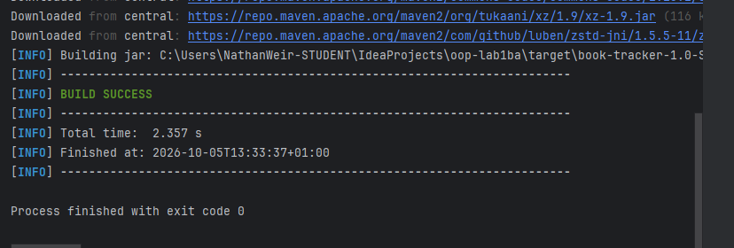
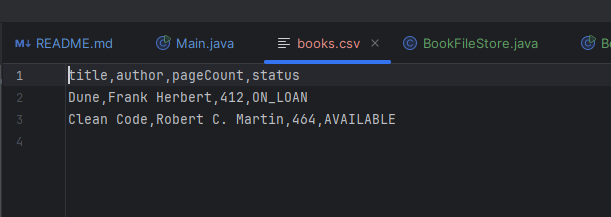

Lab 4 - Collections
- Lab4 changes LibraryService to use List to store multiple books.
- List<Book> tells the compiler that the list conatins Book objects

- Final means the list reference cant be changed
-n
-  findBookByTitle returns the book if a known title and null for unknown
- removeBook reuses findBookByTitle to search and remove a book instead of repeating another search 
- Main runs the program, LibraryServices manages the collection and Book is each book
- 

Lab 5 - Exceptions,CSV and Library Persistence
- The throw statement uses and exception where as the caller uses catch block to handle it
- Path.of creates a file path Files.exists tests wether or not a file exists
- Unchecked NumberFormatException checks if string cant be converted to a number and checked IOException occures during file operations
- Path is the location of a file while files is there so operations can work on the file
- 